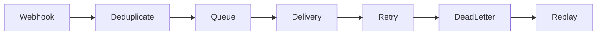

# Reliable Relay

**See what happens after webhook delivery fails.**

[](https://github.com/ashutosh0sharma1/reliable-relay/actions/workflows/ci.yml)

## What you can do

Durable SQLite intake, deduplication, retries, dead letters, explicit replay and a dashboard with a simulated CRM.

## How it works



## Quick start

```sh
python -m venv .venv
# Activate .venv, then:
python -m pip install -r requirements.txt
python -m uvicorn app:app --host 127.0.0.1 --port 8807 --workers 1
```

## Verify

```sh
python -m unittest test_relay -v
```

[VALIDATION.md](VALIDATION.md) records checks actually run against this export and their limits.

## Boundaries

Unauthenticated local demo with synthetic inputs and an in-process CRM. Production needs authentication, webhook signatures, scheduling and monitoring.

## Contribute

Start with a small synthetic reproduction. Improvements to portable setup, failure recovery, documentation and regression coverage are welcome. Read [CONTRIBUTING.md](CONTRIBUTING.md) before opening a pull request.

## License and provenance

See [LICENSE](LICENSE) and [THIRD_PARTY_NOTICES.md](THIRD_PARTY_NOTICES.md). This clean source export excludes private data, credentials and development history.
